在日常研发讨论中，关于大模型写代码有两个截然相反的极端观点：

- **狂热派**：“AI 单步写代码的正确率已经超过绝大多数初级工程师了，以后完全不需要人去 Review，甚至测试都可以让 AI 自闭环。”
- **怀疑派**：“AI 经常暗戳戳埋坑，稍微复杂的工程任务就会跑偏，根本进不了严肃的生产交付链路。”

作为一名每天都在跟自动化流水线和 AI 网关打交道的测试开发工程师，我认为这两派都只看到了局部现象。**AI 编写代码到底需不需要 Review？在什么阶段 Review？怎么审才不会帮倒忙？** 这绝不是一个凭主观经验站队的话题，而是一道由**概率连乘、误伤率硬顶、上下文偏置与返工期望**构成的冷酷数学题。

先把核心公式和参数列在这里，本文就用这几个简单数学推导，把开发与测试场景拆个明白：

:::note
- **$n$**：完成一个开发任务所需的连续生成/工具调用步数（通常 $n \ge 10$）
- **$e$**：单步基础错误率（哪怕顶级模型，通常也存在 $e \approx 1\%$ 的局部幻觉）
- **$d$**：真缺陷被 Review 成功抓出的比例（**检出率 / Recall**）
- **$a$**：原本正确的代码被 Review 改坏的比例（**误伤率 / False Positive**）
- **$\rho$**：错误中属于“前提/需求理解错误”的比例（无法被同上下文模型检出）
- **$\omega$**：多轮 Review 之间的盲区重叠度
- **$R$**：Bug 逃逸到后期的返工成本与单次生成成本的比值
:::

---

## 一、 连乘断崖：把“掉分”写成乘法

在严肃的代码开发中，任何一个特性需求、接口改造或 Bug 修复，从来不是一次 `prompt -> response` 就能交差的。从拉取代码、理清调用链、修改接口定义、改写业务逻辑，到补全单测、跑回归套件，通常需要 **10 步以上的 Agent 循环与工具调用**。

假设当前的模型极其优秀，**单步正确率高达 99%**（错误率仅 $e = 1\%$）。

我们看看连续执行 10 步的整体正确率会变成什么样：

$$0.99^{10} \approx 0.904$$

换成大白话：
> **单步只错 1%，十步串联下来，整件事有 9.6% 的概率是废的。**  
> 失败率直接从 1% 飙到了 9.6%，差不多放大了十倍！这就是多步长链任务中“可靠性断崖式下跌”的准确含义。

### 为什么说 90.4% 还只是个“极其乐观”的幻觉？

$0.99^{10}$ 的计算隐藏了一个至关重要的前提假设：**每一步在统计学上是相互独立的**（第 3 步做错了，第 4 步还有机会自己发现并改过来）。

但在软件工程与 Agent 实际运行中，**中间产物是具有强级联依赖的**：
1. **第 2 步**：模型看错了数据库表的一个状态字段；
2. **第 3 步**：它顺着这个错误的字段生成了整套 ORM 查询；
3. **第 4 步**：它在业务层发现查询返回为空，于是自作聪明加了一套兼容补丁；
4. **第 5 步**：它为这套自洽但完全错误的逻辑写了一套全绿的自动化单测。

**错的中间结果会被当成坚实的新前提继续往下盖楼。** 真实工程环境里的级联失败率，远远高于纯理论计算的 9.6%。

---

## 二、 靠“提高模型能力”硬扛，代价有多大？

面对这个掉分速度，一种常见的直觉是：“既然单步有错，那等下一代基座模型出来，等模型更聪明不就行了？”

我们算算看：如果要让一个 10 步的工程任务整体达到 **99% 的交付可用率**，单步正确率需要达到多少？

$$0.99^{1/10} \approx 0.9990$$

也就是说：**单步错误率必须从 1% 强行压到 0.1%——模型能力需要提升整整十倍！**

在 Scaling Law 边际收益递减的今天，把大模型的单步幻觉再压低一个数量级，需要投入数以亿计的算力与前沿数据清洗成本。

这就是 Review 该出场的位置：
> **Review 的数学本质，不是让生成模型强十倍，而是把已经存在的 1% 抓掉大部分。**  
> 这两件事在工程落地上的难度差了一个量级。

| 解决路径 | 核心手段 | 目标单步错误率 | 达成难度与工程代价 | 结论 |
| :--- | :--- | :--- | :--- | :--- |
| **路径 A：靠基座硬猜** | 堆参数、换超大模型 | $1\% \to 0.1\%$ | 模型综合推理能力需提升 **10 倍**（边际成本极高） | 不现实 ❌ |
| **路径 B：工程 Review** | 引入外部审查与验证 | 残余从 $1\% \to 0.1\%$ | 只需把原有 1% 里的 **90%** 抓出来 | **降维打击 ✔️** |

---

## 三、 Review 的数学算式：最该注意的参数是 a

给开发流程引入 Review 后，代码质量是如何被重塑的？我们只需要关注两个核心参数：
- **$d$（检出率 / Recall）**：真缺陷里被 Review 成功抓出来的比例；
- **$a$（误伤率 / False Positive）**：Review 自作聪明把原本写对的代码改坏、或者引入新幻觉的比例。

设单步原始错误率为 $e = 1\%$：
- 逃逸的真实缺陷：$e \cdot (1 - d)$
- 额外引入的误伤：$a$
- **单步残余错误率**：$e_{\text{res}} = e(1 - d) + a$
- **十步任务整体正确率**：$[1 - e(1 - d) - a]^n$

代入具体数据（$e = 1\%,\, n = 10$）看收益：

| 审查情形 | 检出率 $d$ | 误伤率 $a$ | 单步残余错误 | 十步整体正确率 | 十步整体失败率 |
| :--- | :--- | :--- | :--- | :--- | :--- |
| **不 Review** | - | - | **1.0%** | **90.4%** | 9.6% |
| **及格线 Review** | 80% | 0.1% | **0.3%** | **97.0%** | 3.0% （失败率砍掉约七成！） |
| **高质量 Review** | 90% | 0.1% | **0.2%** | **98.0%** | 2.0% |
| **确定性门禁组合** | 95% | 0.05% | **0.1%** | **99.0%** | 1.0% （媲美提升十倍的模型） |
| **喜欢瞎改的 Review**| **100%** | **1.0%** | **1.0%** | **90.4%** | **9.6% （等于根本没审！）** |

从第一行到第二行：**失败率从 9.6% 直降到 3.0%，砍掉约七成**，代价仅仅是多跑了一遍审查。

### 这个式子里，最该警惕的是误伤率 a

我们来看极限情况：假设 Review 拥有神一般的洞察力，$d = 100\%$（能捕获所有的原有 Bug）。  
此时 $e(1-d) = 0$，整体正确率公式直接退化为：

$$(1 - a)^n$$

**结论很无情：Review 哪怕再能抓 Bug，它的质量上限也永远压不过它自己的误伤率 $a$。**

代入一个真实数：如果一个审查者喜欢乱提建议、乱改逻辑，导致误伤率 $a = 1\%$：  
哪怕它的检出率 $d = 100\%$，十步之后的整体正确率依然是：

$$(1 - 0.01)^{10} = 90.4\%$$

**和根本不 Review 一模一样！** 抓掉的 Bug 和新改坏的逻辑刚好完全抵消。

---

## 四、 测试场景落地：为什么“带真值的工具”碾压“AI 自审”？

这个数学事实，直接解释了为什么在代码开发和测试场景中，不同验证手段的真实效果天差地别：

### 1. 纯 LLM 同会话自审（Prompt: "请帮我仔细检查这段代码是否有 Bug"）
此时模型缺乏外部环境反馈，误伤率 $a$ 相当大。它经常会：
- 把原本合理的防御性边界判断当成“冗余逻辑”删掉；
- 建议你把正确的类型注解改错；
- 为了显得“有产出”而凭空捏造不存在的优化建议。

### 2. 带外部真值（Ground Truth）的验证手段
- **静态类型系统与编译器**（TypeScript / Mypy / Rustc）
- **代码静态分析**（Linter / Ruff / SonarQube）
- **确定性测试断言**（Pytest / Jest 单元测试与集成测试）

这类工具的特性是：**误伤率 $a \approx 0$**。编译器报错就是报错，类型不匹配就是不匹配，测试跑红就是跑红。它没有“画蛇添足”的概率。

:::tip 工程黄金法则
**永远不要让大模型肉眼去查“编译器跑一遍就能报错”的问题。**  
把代码直接扔进带类型检查、Linter 和自动化测试的确定性执行沙箱里，才是把误伤率 $a$ 压到极限的唯一解法。
:::

---

## 五、 为什么必须换上下文？局部错 vs 前提错

在实际工程中，缺陷并不是均匀分布的。我们可以把代码错误精细拆成两类：

1. **局部错（Local Error）**：拼错变量名、边界判断 off-by-one、漏了特定返回值判断。这类错误占绝大多数（设占比 $1-\rho$），审查者很容易抓出，检出率为 $d$。
2. **前提错（Premise Error）**：一开始就把需求方向理解偏了、看反了业务交互协议、对系统状态机的假设从根上就是错的。这类根本性错误占比为 $\rho$（通常在 30% 上下）。

### 同一会话自审：帮自己圆谎

如果让同一个上下文（原生成会话）的 AI 来审查自己写出来的代码：
> 因为它的推理链、上下文记忆和最初的 Prompt 完全相同，它对“前提错”的检出率基本为 **0**。  
> 它不会觉得前提有错，反而会根据那个错误的前提，证明自己的代码写得“非常合理”。

- **同上下文的有效检出率**：$d(1 - \rho)$
- **换了独立上下文（新 Session / 独立测试 Agent）的有效检出率**：$d(1 - \rho) + d' \rho$  
  （其中 $d'$ 是无偏见的新视角对前提错误的检出率）

代入一组实际经验值（$\rho = 0.3,\, d = 0.8,\, d' = 0.7$）：
- **同上下文自审**：有效检出率为 $0.8 \times (1 - 0.3) = 0.56$
- **换独立上下文**：有效检出率为 $0.56 + 0.7 \times 0.3 = 0.77$

把它们代回十步整体正确率模型（设 $a = 0.1\%,\, e = 1\%$）：
- 同上下文自审的整体正确率：**94.7%**
- 换独立上下文的整体正确率：**96.8%**

> **差出的 2.1 个百分点，全部来自“新视角没有继承你的错误前提”。**  
> 换一个新会话，并不是因为新模型更聪明，而是因为它**不知道你当初想当然脑补了什么，所以绝不会替你圆场**。

### QA 场景的警惕点：套套逻辑（Tautological Tests）

这也是测试工程中最恶名昭彰的陷阱：**绝对不要让写代码的同一个 AI 会话顺手给自己补全单测！**

同上下文写出来的单测，往往是“实现驱动”的：AI 会把刚刚写出来的 Bug 行为当作客观事实来写 `assert`。结果就是**测试用例全绿，但业务功能全错**。  
正确的做法是：**切断上下文，只把需求规格书（PRD）和接口协议喂给独立的测试 Agent，背靠背编写黑盒/灰盒断言。**

---

## 六、 终极算账：什么时候该 Review？

做技术决策离不开经济账。审查需要额外的 Token、计算时间与人工精力。

设单次生成的基础成本为 $1$。一旦 Bug 穿透到后续阶段，**整条链路重跑、调试、洗数据的返工成本是一次生成成本的 $R$ 倍**。

我们来对比总成本期望：
- **不 Review 的总成本期望**：$1 + 0.096 R$
- **增加 1 次有效 Review 的总成本期望**：$2 + 0.030 R$

令两者的成本期望相等，求平衡点临界值 $R^*$：

$$1 + 0.096 R = 2 + 0.030 R$$
$$0.066 R = 1 \implies R^* \approx 15.15$$

结论非常明确：
> **只有当“逃逸缺陷的返工代价”超过“单次生成成本的 15 倍”时，做 Review 在数学期望上才稳赚不赔！**

- **高返工代价场景（$R \gg 15$）**：  
  在严肃的业务系统、对外 API、数据库变更和发布流水线中，Bug 漏到生产环境或联调环境，返工代价 $R$ 往往在 **30 到 100 倍**以上（涉及多团队扯皮、回滚部署、脏数据修复）。**此时 Review 是暴利投资，能直接省下 40% ~ 50% 的综合成本。**
- **低返工代价场景（$R < 15$）**：  
  如果是本地临时写的抓数小脚本、一次性数据分析探针，总共就两三步，执行报错随手再敲一句，此时的 $R^* \approx 70+$。强行加 Review 流程在经济账上是纯亏的。

### 为什么不能“同一份代码连续审 3 遍”？

既然 Review 这么赚钱，为什么不多审几遍？

因为**边际收益是指数衰减的**。第二次 Review 的增量检出率并不是 $d$，而是 $\omega \cdot d$（其中 $\omega$ 是两次审查视角的盲区重叠度，通常在 0.5 左右）；到了第三次审查，增量收益进一步衰减为 $\omega^2 \cdot d$。

而成本却是线性累加的。因此：
> **“换视角”远比“重复审”值钱。**  
> 换独立上下文、换关注点（这次只看异常流，下次只看并发竞态）、换异构模型、引入自动化测试套件，永远比让同一个模型“再审一遍”高效得多。

---

## 七、 落地指引：AI 研发与测试的四级防御漏斗

综合上述所有数学结论，在团队日常研发与 CI/CD 落地中，我们推荐建立以下四级质量防御体系：

1. **第 1 道防线：压死误伤率 $a$（确定性工具先行）**  
   代码生成完成后，第一步先跑编译器、Linter 和类型系统（mypy / TypeScript）。用 $a \approx 0$ 的确定性工具秒级消除低级拼写和语法缺陷，绝不耗费 LLM 算力去找这些问题。
2. **第 2 道防线：阻断前提错 $\rho$（背靠背契约单测）**  
   严格切断代码生成的会话历史。让独立的测试流程只依据需求规格书（PRD）生成断言，杜绝模型自洽的“套套逻辑伪单测”。
3. **第 3 道防线：定向抓局部 $d$（专项 PR 审查）**  
   进行 AI Code Review 时，必须把审查职责切碎（单一职责）：一轮只抓 SQL 与鉴权安全，一轮只看高并发与锁，一轮只看资源泄露与超时。聚焦单一目标，彻底打破盲区重叠度 $\omega$。
4. **第 4 道防线：守住高返工 $R$（高危发布门禁）**  
   对于返工代价极高（$R > 15$）的核心架构、数据库 DDL、计费等核心业务，强制保留完整的回归测试套件全绿，并由资深研发/QA 进行最终签字。

---

## 结语

回到最初的问题：**AI 编写代码是否需要 Review？**

数学给出的答案是：  
**它极度需要 Review，但它不需要“形式主义的 Review”。**

那种让写代码的同一个模型在同一个对话框里“自我反思”的假 Review，在数学上甚至不如不审；而**用确定性工具压死误伤率 $a$、用独立上下文打碎前提错 $\rho$、在返工倍数高的地方建立工程漏斗**，才是我们在 AI 时代把代码质量真正做扎实的确定性底牌。
