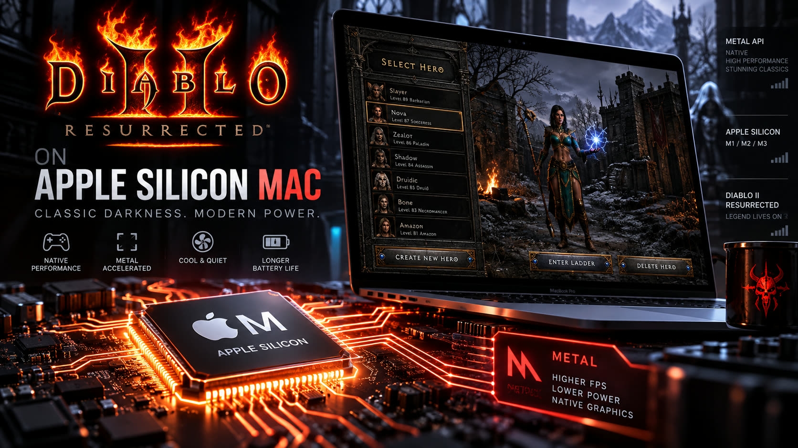
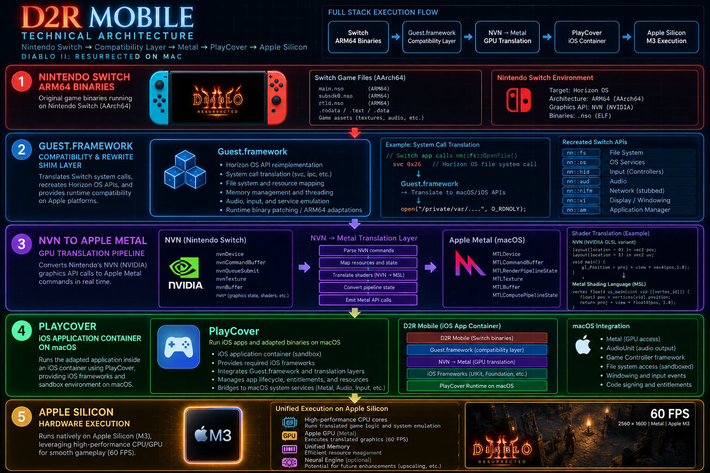
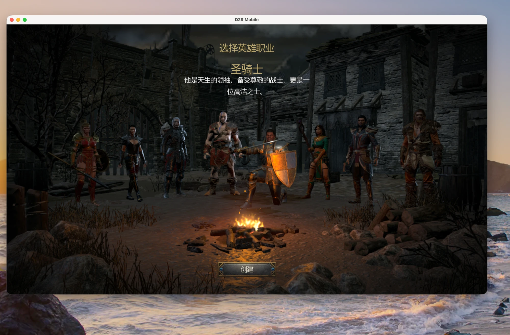

想在一台 M 系列 Mac 上跑《暗黑破坏神II：重制版》，多数人第一反应是去找模拟器——Yuzu、Ryujinx 那一类。这条路能走通，但代价很实在：CPU 指令要逐条翻译，JIT 抖动、着色器卡顿、还得跟系统更新赛跑。

`jiayx/d2r-mobile-build` 这个项目走的是完全不同的路线，而且它自己就把话说得很直白：

> **This is not emulation.** The game runs as **native ARM64** on Apple Silicon with **zero JIT overhead**.

原因很简单——**Switch 的主 SoC（Tegra X1）和 Apple Silicon 跑的是同一套 AArch64 指令集**。指令集相同意味着机器码可以直接执行，不需要逐条翻译。构建报告里那句 `"guest_arm64": true` 说的就是这件事：客机是 ARM64，宿主机也是 ARM64，CPU 这一层几乎是白送的。

那工程量去哪了？只剩两件事：**系统调用映射**（Horizon OS 的文件/输入/网络服务 → iOS/macOS 框架）和**图形 API 重写**（NVN/GX2 → Metal）。这两层才是真正花时间的地方，也决定了这类移植能不能"原生流畅"。

| 层 | 提供者 | 作用 |
| --- | --- | --- |
| 指令执行 | Apple Silicon（原生 AArch64） | 直接跑，零解释开销 |
| 图形 API | Metal 重写层 + 预编译着色器 | NVN 调用落到 Metal，走 GPU 硬件加速 |
| iOS 容器 | **PlayCover Community** | iOS 运行环境、Metal 加速、键鼠映射 |
| 游戏资源 | RomFS `.data` 档案 | 内容本体（模型、贴图、音频） |



## 拆开看：包、资源、容器

### 应用包（IPA）

| 项 | 值 |
| --- | --- |
| 文件 | `D2RMobile-v1.0.15.ipa` |
| 最低系统 | iOS 26.0 |
| iOS 18–25 | 用同 release 的 `D2RMobile-v1.0.15-ios18.ipa` |
| 签名 | **未签名**，需自签（Sideloadly / SideStore / AltStore） |
| 内置着色器库 | **6,927** 个预编译 Metal 着色器 |
| 版本 | 游戏 `3.3.94012`，Switch 侧 `1.0.34.0`，构建产物 `3.3.94012-r44` |

构建走 GitHub Actions，一次约 297 秒，同时产出 iOS 与 macOS 两套包。

### 资源包（RomFS）

| 项 | 值 |
| --- | --- |
| 档案数 | **18 个 `.data`** |
| 解压后体积 | **5,561,224,037 B ≈ 5.56 GB** |
| 分卷压缩包 | ≈ 5.42 GB，切 3 卷（约 1.90 + 1.90 + 1.62 GB） |
| 额外包 | `Legacy-Device-Pack.zip`，**A14–A16 设备必须** |
| 设备门槛 | A14 / M1 或更新，内存 ≥ 6 GB |

一个很容易踩空的细节：**资源分卷不在 IPA 那个 release 里**。`v1.0.15` 只放 IPA、校验和、构建报告和几个 JSON 清单；资源挂在**另一个按内容哈希命名的 data release** 上，`RESOURCE-INSTALL.txt` 里给了跳转链接——别在 IPA release 页里翻。

### 为什么第一次启动特别慢

构建报告里有一条关键信息：

```json
"startup_prefetch": false,
"startup_prefetch_reason": "The pinned official public shell omits the unpublished bootlist;
                             the host supports no prefetch when absent."
```

翻译成人话：官方公开的运行时壳里缺一份"启动预取清单"，于是**启动阶段不能预取着色器**。虽然 IPA 里已经预编译了 6,927 个 Metal 着色器库，首次运行仍要把 Switch 侧着色器补齐编译成本地 Metal MSL 缓存——这就是首启要等几分钟的根本原因。

- 官方参考值：iPhone 17 Pro Max 上首次编译约 **6 分钟**；
- Mac 端实测：`boot.txt` 里记录待编译数量约 **7,212 个**（比 IPA 内置的 6,927 多，属于运行期补齐的部分）；
- 缓存落盘后，**第二次启动秒进**。

判断方法：别盯着游戏窗口，盯 `boot.txt` 的增长。进度在走，就不是卡死。

## 一句话交给 AI 代理，全自动装完

这是整个方案里最"2026 年"的部分。把下面这段原样发给任意一个**能执行 shell** 的 AI 代理（Claude Code / Hermes / Codex 都行），安装全流程可以无人值守跑完：

```markdown
请帮我在当前这台 Apple Silicon Mac 上全自动安装并运行 D2R Mobile（暗黑破坏神II：重制版）：

1. 用 brew 安装 PlayCover：`brew install --cask playcover-community`；
2. 从 release 页 https://github.com/jiayx/d2r-mobile-build/releases/tag/v1.0.15 下载
   `D2RMobile-v1.0.15.ipa`（macOS 26+ / iOS 26+）或 `D2RMobile-v1.0.15-ios18.ipa`（iOS 18–25），
   以及 `SHA256SUMS.txt`，sha256 校验通过后再安装；
3. 资源分卷不在上面这个 release 里：去配套的 data release 下载
   `D2R-Mobile-Resources.zip.001/.002/.003` + `Resources-Parts-SHA256SUMS.txt`
   + `Resources-SHA256SUMS.txt`（链接见仓库 README 与 RESOURCE-INSTALL.txt）；
4. `shasum -a 256 -c Resources-Parts-SHA256SUMS.txt` 校验分卷 →
   `cat D2R-Mobile-Resources.zip.00{1,2,3} > D2R-Mobile-Resources.zip` →
   `shasum -a 256 -c Resources-SHA256SUMS.txt` 校验合并包 → 解压得到含 18 个 `.data` 的
   `D2R Mobile Resources` 文件夹；
5. 用 PlayCover 安装该 IPA，把 `D2R Mobile Resources` 软链到
   `~/Library/Containers/org.d2rmobile.app/Data/Documents/`；
   （A14–A16 机器额外下载 `Legacy-Device-Pack.zip`，解压后与 `D2R Mobile Resources` 并排放在同一目录）
6. 【关键防御】先退出 PlayCover，再用 plutil 把
   `~/Library/Containers/io.playcover.PlayCover/App Settings/org.d2rmobile.app.plist` 中的
   `customScaler` 改为浮点数 1.0，`windowWidth` / `windowHeight` 设为 1920 / 1080。
   原因：默认 Retina 2x 超采样会把 1080p 渲染目标放大到 3840×2160（约 830 万像素），
   突破游戏内显存分配预算，必然在 main+0x17417a4 触发 SIGSEGV 崩溃；
7. 启动 `/Applications/PlayCover/D2R Mobile.app`，监控容器内 `boot.txt`，
   等 7,000+ 个 Metal 着色器编译完成、画面进入主菜单；
   完成后告诉我结果（是否进主菜单、耗时多久）。
```

两个前置条件：① 代理必须**能跑 shell**（纯对话模型只能给你念步骤）；② 机器必须是 **Apple Silicon + macOS 26 或以上**（iOS 18–25 走对应版本包）。

## 最硬的那个坑：为什么 Retina 屏上第一次必崩

这是整套流程里**唯一一个"不做就必崩"**的步骤，也是全文技术含量最高的一段。

### 崩溃现场

```text
Exception Type: EXC_BAD_ACCESS (SIGSEGV)
ldr  x8, [x0]              ; x0 == NULL
pc   = main+0x17417a4
lr   = main+0x174b018      ; 返回了 NULL 的那个分配器
```

`ldr x8, [x0]` 在 `x0 == NULL` 时解引用 → 段错误。问题不在这一行，而在**上游那个返回 NULL 的分配器**（`main+0x174b018`）。

### 归因链：像素预算 × Retina 超采样

实测排查出来的因果链是这样的：

1. 游戏内部有一个**显存分配器预算约 512 MB** 的硬边界，对应渲染目标像素上限约 **345 万像素**；
2. PlayCover 默认开启 **Retina 2x**：窗口逻辑分辨率 1920×1080 被超采样成 **3840×2160 = 830 万像素**；
3. 830 万像素 × 多附件（颜色/深度/法线等）瞬间顶爆 512 MB 预算 → 分配器返回 **NULL** → 调用方没做判空 → 解引用崩溃。

一条很干净的对照证据：**2736×1260（约 345 万像素）能正常进游戏**，而 3840×2160（830 万）必崩。边界恰好卡在 345 万这个量级上——说明这不是随机崩溃，而是**可计算、可复现的容量边界**。

### 解法：把缩放锁回 1.0

```bash
# 1) 完全退出 PlayCover（改 plist 前必须退出，否则会被回写覆盖）
osascript -e 'quit app "PlayCover"'

# 2) 关键三项：关闭 Retina 2x 超采样，锁定 1080p
P="$HOME/Library/Containers/io.playcover.PlayCover/App Settings/org.d2rmobile.app.plist"
plutil -replace customScaler -float 1.0 "$P"
plutil -replace windowWidth  -integer 1920 "$P"
plutil -replace windowHeight -integer 1080 "$P"

# 3) 复核
plutil -p "$P" | grep -E 'customScaler|windowWidth|windowHeight'
```

锁定 1080p 后渲染目标是 **1920×1080 = 207 万像素**，只有崩溃阈值的六成，稳稳落在预算内。



**这一步的普适价值**：同类"同指令集移植"项目，崩溃点往往不在 CPU 侧，而在**显存/像素这类硬预算边界**，以及图形 API 语义差异（附件数量、MSAA 倍率、格式支持）。遇到"能启动但一进画面就崩"的移植问题，先算像素 × 附件 × 字节每像素，再对照预算表。

## 首启验证清单

跑完安装后按这个顺序确认，每步都有可观测输出：

| 步骤 | 观测点 | 期望 |
| --- | --- | --- |
| 1 | `shasum -a 256 -c SHA256SUMS.txt` | IPA 校验通过 |
| 2 | 分卷 + 合并包两次校验 | 全 OK |
| 3 | 资源目录 | 18 个 `.data`，合计约 5.56 GB |
| 4 | plist 复核 | `customScaler = 1.0`，1920×1080 |
| 5 | 启动后 `boot.txt` | 着色器数量单调增长至 7,000+ |
| 6 | 编译完成后 | 画面进主菜单，游戏内叠加层帧率读数 60 FPS |

## FAQ

**Q：升级 IPA 后资源要重新导入吗？**
不用。只要配套 data 版本没变（同样的 `game_version 3.3.94012`），已导入的 `D2R Mobile Resources` 可直接复用。

**Q：还是嫌吃显存，能再省一点吗？**
能。分辨率已经锁 1080p，还可以进一步降 `windowWidth/Height`（如 1600×900），或降低 MSAA 倍率。原则始终是"像素数 × 附件数"要留在预算内。

**Q：Intel Mac 行不行？**
不行。全流程的前提是 Apple Silicon（同为 AArch64）与 Metal 硬件加速；Intel 机等于要做 CPU 指令翻译，这条路不成立。

**Q：能不能不装 PlayCover，直接跑 macOS 原生版？**
可以，同一构建同时产出 macOS 包（`macos26.zip` / `macos15.zip`），解压后拖进 Applications，再把随包 `Mac Resource Metadata/data` 里的 `build_manifest.psv` 与 `.build.config` 拷进 `D2R Mobile Resources/data`，首次启动手选资源目录即可。PlayCover 路线的优势是资源导入一次、键鼠映射现成；原生路线少了容器一层，但要自己管资源路径。

**Q：资源哪来的？**
游戏数据需自备正版，RomFS 资源由合法持有者自行准备/构建。本文只讨论**架构与安装工程**，不提供游戏内容。

## 一句话总结

> 指令集相同（AArch64 → AArch64）让这类移植在 CPU 层几乎"免费"，工程成本全部转移到**系统调用映射**与**图形 API 重写**上；而真正会让人卡一整天的崩溃，往往不是算法问题，而是**显存/像素预算这种硬边界**——把 Retina 超采样从 2x 收回到 1.0，就是本文最值钱的那一行 `plutil`。

---

### 附：本文数据出处

| 内容 | 来源 | 性质 |
| --- | --- | --- |
| IPA 体积 / 最低系统 / 着色器库 6,927 / `guest_arm64` / `startup_prefetch` | `v1.0.15` release 的 `build-report.json` | 构建产物元数据（官方） |
| 18 个 `.data`、5,561,224,037 B、分卷 SHA256 | `resource-manifest.json` / `resources.json` | 构建产物元数据（官方） |
| 分卷下载与校验步骤、6 分钟编译参考值 | `RESOURCE-INSTALL.txt` | 官方安装说明 |
| 设备要求、iOS 版本分流、Legacy 包、macOS 路线 | 仓库 `README.md` | 官方文档 |
| 512 MB 预算 / 345 万像素边界 / SIGSEGV 偏移 / 7,212 着色器 | Mac 端 PlayCover 安装实测 | 单机实测（非官方） |
