DSH（DeepSeek Harness，npm 上的 `@deepseek-ai/dsh`）的预设体系里，有一段配置决定了 Agent「怎么干活」——`persona` 的 `prefix`。官方 `standard` 预设的这一段是这个：

```yaml
prefix: You are a coding agent powered by the {{model}} model.
suffix: Your working directory is {{cwd}}.
```

一句话。官方 `minimal` 预设则是另一种极端：`complete: true`，`prefix` 固定为 `You are a helpful software engineer assistant.`，`includeRuntimeContext: false`——按官方文档说法，这个 agent 身上「其他 prompt section 和面向模型的插件全部缺席」。

两种我都不想要。我想要的是**任务纪律被明文写下来**：别自述、先读后改、改完自己跑测试、别整文件重写。于是写了这个插件：

- 仓库：<https://github.com/ABK3528/dsh-preset-claude-code>（MIT，v1.0.1）
- 形态：DSH bundle 插件。**不 fork 官方、不改官方预设**，只是以一个新 bundle 层的身份，往组合树里插一行自己的 preset
- 效果：新建会话的预设列表里多一个「Claude Code 模式」，`order: 0`，排在官方 `standard`(1) / `ptc`(2) / `minimal`(3) / `cordis`(4) 之前
- 实测（同一模型、同一道题、只换 persona 那一段）：输出 token **1483 → 851**，工具调用 10 → 8，墙钟 10s → 7s，正确性不变

一句话概括这件事：**DSH 的「风格」不是模型参数，是预设里的一段提示词——所以想换风格不用换模型，装一个 preset 插件就行。**

## 一、我在 DSH 上遇到的四个痛点

### 1.1 引擎很强，但「怎么干活」没人管

DSH 把一件事分得很清楚：模型、工具、上下文、权限都是组件，而**一个 Agent 的行为风格几乎全压在 `persona` 这一段上**。官方四个预设里，`standard` 的人设就是上面那一句话，其余靠模型本能。

于是同一道题，在默认人设下会变成这样：它先解释一遍自己准备做什么，再动手，最后交一份 1220 字节的汇报；而我要的其实只是「改完，跑通，告诉我改了什么」。（这个数字不是印象，是下面第四节的实测结果。）

这不是模型能力问题，是**提示词里没有约束**。Claude Code 的提示词里，「不要叙述你即将做什么」「动手前先读文件」「改完主动验证」是明文条款；在 DSH 默认预设里，这些条款不存在。

### 1.2 想改风格，三条路都不顺手

| 做法 | 为什么不顺手 |
| --- | --- |
| fork 官方 bundle | 改动面太大，官方一升级就要重放，等于自己维护一个分叉 |
| 直接改 `~/.dsh` 里的预设行 | 能生效，但没法分发、没法版本化，换台机器重来一遍 |
| 把 `persona` 行挂在 preset **外面** | **直接失败**：官方文档说得很明确，`dsh-persona` 行是 scope-only 的，挂在 agent scope 之外会「与 prompt registry 自己的 `deployment:persona-prefix` 注册相撞并 fail loud」 |

第三条是我最初的做法，启动即报错。它反过来解释了这个插件的形态：**persona 必须装进一个 preset 里，而不是挂在外面**——因为一个进程里的「全局人设」已经有主了，这个行的存在意义就是「针对某一个 agent 把它顶掉」。

### 1.3 我在多个 harness 之间来回切

我平时会在几个 CLI agent 之间切换。提示词纪律不统一，切换成本全落在人身上：这个要提醒它先读代码，那个要提醒它跑测试。把 Claude Code 那套纪律抽成 DSH 的一个预设，本质上是把「我的工作方式」从某个具体工具里解耦出来，变成一份可安装、可版本化的配置。

### 1.4 最坑的一点：装上了 ≠ 生效了

这个坑值得单独一节，因为它同时也是这次改动里最值钱的发现——见第三节。

## 二、插件的做法：不 fork，只插一行

### 2.1 DSH 的组合是分层的

官方 `apps/cli/reference/README.md` 把启动时的配置组合规则写得很清楚，配置树是这样叠出来的：



> 原文：*the effective tree is composed over an empty root by applying, in order: each bundle patch named in the profile manifest's `dsh.profile.bundles` list, the profile's own `cordis.patch.yml`, the home-level `$DSH_HOME/cordis.patch.yml` … and each `--patch` overlay in argv order. Later layers win per row; a patch replaces the targeted row's complete `config` value rather than deep-merging keys, and may insert new rows.*

两句话翻译过来：**后面的层按行覆盖前面的层**，而**补丁是「整行替换」，不是深合并**。这两点决定了插件的全部写法：

- 插件以「一个新的 bundle 层」的身份出现 → 官方那四个预设一行都不用动，我的 `order: 0` 只是排在它们前面；
- 因为 `config` 是整行替换 → 写 preset 时必须把 `config` 写全，别指望和官方默认值合并。这是我踩的第二个坑：第一版写了残缺的 `config`，`--dump-config` 一出来默认值全丢了。

### 2.2 这个插件的实体，是一份 patch 文件

`lib/index.js` 只有 396 字符，就是宿主生命周期入口：

```js
export default class ClaudeCodePresetPlugin {
  static name = 'dsh-preset-claude-code';
  constructor(ctx, config) { this.ctx = ctx; this.config = config || {}; }
}
```

真正干活的是 `cordis.patch.yml`——一份声明式补丁：

```yaml
# dsh bundle patch: inserts Claude Code agent preset into DSH host composition
- insert:
    - id: preset-claude-code
      name: '@deepseek-ai/dsh-agent-preset'
      config:
        id: claude-code
        name: Claude Code 模式
        order: 0
        plugins:
          - id: persona
            name: '@deepseek-ai/dsh-persona'
            config:
              complete: true
              includeRuntimeContext: true
              suffix: Your working directory is {{cwd}}.
              prefix: >-
                You are Claude Code, Anthropic's official CLI ...
                # Core Operating Principles 1. Direct Action: ...
          # ... 省略：工具行与两个隔离组，见下图
```

好处是简单、可审计：一个 preset 长什么样，读 YAML 就知道。代价也很直接——**`test/validate.test.js` 只能做静态断言**（检查 patch 文本里必须出现 `@deepseek-ai/dsh-persona`、`@deepseek-ai/dsh-tool-bash` 等字样），它验证不了「装上去之后真的生效」。1.4 那个坑就是这么漏过去的。下一步我打算把 `dsh --dump-config` 的输出做成快照测试，让「生效」这件事也有断言。

### 2.3 preset 里面装了什么



| 行 / 组 | 作用 | 关键配置 |
| --- | --- | --- |
| `persona` | 身份与行为纪律，接管 system prompt | `complete: true`、`includeRuntimeContext: true` |
| `agent-instructions` | 读 `AGENTS.md` / `CLAUDE.md` | `maxBytes: 65536` |
| 工具行 | bash / pwsh（按平台二选一）、fs、fs-search、jobs、skill-filesystem、tool-skill、goal、todo、ask-user、web、present | `disabled: !!js process.platform === 'win32'` |
| `planning` 组 | 计划模式（动代码前先说方案） | `group: true`、`isolate: { planMode: true }` |
| `compaction` 组 | 压缩、`/compact`、工具结果剪枝 | `isolate: { compaction: true, toolResultPruner: true }` |

三个设计决定，每个都有明确的理由：

**① 为什么 `complete: true`。** 官方文档说，开了它之后「prompt registry 会把这段 prefix 恢复成唯一的 section；身份、后缀、工具指引、监听器都不能再追加提示词文本」。等于把「这个 agent 是谁」完全交给这一段，所以它必须自己把该说的说完——我配 `includeRuntimeContext: true` 把工作目录之类的运行时上下文补回来，否则连这些也会被抑制掉。

**② 为什么工具行要一行行显式列。** preset 是完整组合，不是增量。想让它手里有什么牌，就写什么。

**③ 为什么用 `isolate` 组。** planMode 与 compaction 各自隔离成组，避免和宿主重复注册同一批服务。

### 2.4 提示词里我都写了什么

不是照抄，是按「我在 DSH 上真正想让模型改掉的行为」列的：

1. **直接行动**——不要在做之前叙述你即将做什么，直接调工具；纯文本回复（除最终交付）控制在 1–2 句；
2. **先读后改**——动手前必须读文件和检索代码，不许猜文件结构、行号、函数签名；
3. **手术刀编辑**——优先精确字符串替换，而不是整文件重写；
4. **执行与自愈**——改完主动跑测试/静态检查，报错就读栈修因再验证；
5. 另外三条：**上下文经济**（定向读取，别灌上下文）、**原生斜杠工作流**（`/init`、`/doctor`、`/compact`、`/review`）、**权限与安全边界**（破坏性操作要谨慎，严格留在工作区内）。

## 三、实测一：装上去，但没生效

装好包、重启客户端、新建会话——预设列表里什么都没有。翻日志找到了这句话：

```bash
$ dsh plugin --profile t1 add link:/path/to/dsh-preset-claude-code
dsh: initialized profile t1 at ~/.dsh/profiles/t1
+ dsh-preset-claude-code link:/path/to/dsh-preset-claude-code
dsh: warning: dsh-preset-claude-code declares no dsh.bundle
     — installed as a plain dependency, not a profile layer
```

包确实装进了 `node_modules`，但**它从来没有进入组合树**。证据两条：

```bash
# profile manifest 里的 bundle 列表，没有我的包
$ python3 -c "import json;print(json.load(open('~/.dsh/profiles/t1/package.json'))['dsh'])"
{'profile': {'bundles': ['@deepseek-ai/dsh-base']}}

# 组合树里搜不到我的 preset
$ dsh --profile t1 --dump-config | grep -c preset-claude-code
0
```

原因在官方文档里写着：`dsh plugin add` 成功之后，DSH 会拿安装结果去对账 `dsh.profile.bundles`——**「每个解析到声明了 `"dsh": { "bundle": { "patch": "./cordis.patch.yml" } }` 的包的依赖会加入层栈」，没声明的「只作为普通依赖保留，并给一次性警告」**。我的 `package.json` 里当时没有这个字段。

修法四行 JSON：

```json
{
  "dsh": { "bundle": { "patch": "./cordis.patch.yml" } }
}
```

再装一遍，证据反转：

```bash
$ dsh plugin --profile t2 add link:/path/to/dsh-preset-claude-code-fixed
$ python3 -c "...['dsh']"
{'profile': {'bundles': ['@deepseek-ai/dsh-base', 'dsh-preset-claude-code']}}

$ dsh --profile t2 --dump-config | grep -n "preset-claude-code" | head -3
362:# == dsh-preset-claude-code
363:- id: preset-claude-code
367:    name: Claude Code 模式
```

（顺带一提：`--dump-config` 会给每一行标出它来自哪个层——`# == dsh-preset-claude-code` 就是这一行来自哪个 bundle 的证据。查「我的插件到底进没进树」，这一个命令够了。）

:::warning
**教训：插件「装上了」和「生效了」是两件事。** 判定标准只有一个——组合树（dump）里有没有你那一行。这个坑不是靠读文档能避免的：README 的安装说明照着 pnpm 的习惯写，`pnpm add` 返回成功，人自然认为成功了。
:::

## 四、实测二：换 persona 到底值多少

「回复变短了」这种话不算结论，所以做了一次尽量只动一个变量的对照。

**设置**（除了 persona，全一样）：

| 维度 | 值 |
| --- | --- |
| 引擎 | DSH `0.2.0-rc.2`，`--profile headless` 一次性任务 |
| 模型 | `deepseek-official` / `deepseek-flash`，`reasoningEffort: high` |
| 权限 | permission preset `workspace-write`，approval `ask` |
| 任务 | 仓库里一个带两个 bug 的 `mathx.py` + 一个可执行测试脚本 |
| 唯一变量 | agent 的 persona 前缀：**A** 用 DSH 默认 `standard` 那一句；**B** 用插件的 Claude Code 前缀 |

两个测量细节值得说一下，因为它们让「感觉」变成了「数」：

- **测试到底跑没跑**：测试脚本每次被执行都往 `runs.log` 追一行。模型说「测试通过」不算数，文件里的记录才算。
- **token 与工具调用**：从 `$DSH_HOME/sessions/**/session.v4.jsonl.zstd`（多帧 zstd）解出事件流，统计 `assistant/message` 的 `usage` 和 `tool/call` 的计数，不靠肉眼估。

| 指标 | A · 默认 standard persona | B · Claude Code persona |
| --- | --- | --- |
| 输出 token | 1483 | **851（-43%）** |
| 工具调用总数 | 10 | 8 |
| ├ `bash` | 5 | 3 |
| ├ `read` | 3 | 2 |
| ├ `glob` | 0 | 1 |
| └ `edit` | 2 | 2 |
| 步骤数 | 6 | 6 |
| 墙钟 | 10 s | 7 s |
| 最终答复长度 | 1220 B | **399 B** |
| 测试执行次数 | 2（复现 + 验证） | 2（复现 + 验证） |
| 结果 | 两个 bug 都修好 | 两个 bug 都修好 |

比 token 数更有意思的是**工具路径变了**。默认人设下它用 `bash` 去探路（5 次）；Claude Code 人设下变成先 `glob` 找结构、再 `read` 读文件，`bash` 只用来跑测试（3 次）。这不只是「话少了」，是行为路径变了——从「边试边看」变成「先定位再动手」。

:::note
**边界要说清楚**：n=1，一道题，一次运行，样本小，只说明方向，不构成基准测试。另外这次实验是把 persona 前缀挂到 deployment 的 `system-prompt` 行上跑的（headless 一次性任务没有预设注册表，没法选预设），所以它衡量的是**提示词那部分的收益**，不等于整个 preset 的收益。要更硬的结论，需要多题、多次、多模型地跑。
:::

## 五、使用感受

**先说好的：**

- 最直观的变化是**动手变早了**：默认人设下它习惯先叙述再执行，现在是直接调工具；`complete: true` 把身份完全接管之后，这种自述倾向被压得很明显。
- **改完会自己跑测试**，报错自己读栈、自己修、再验一遍——这是我手动提醒次数掉得最多的一项。
- **plan mode 那条最实用**：动代码之前先把方案摆清楚、等 `exit_plan_mode`。这段「架构师姿态」是写进 `plan-mode` 的 `section` 里的，所以它是提示词级的约束，不是靠模型自觉。
- 工具集是显式列的，所以我很清楚「这个模式下模型手里有什么牌」，而不是跟着宿主走。

**再说代价和还没解决的：**

1. **`>-` 折叠标量把编号列表拍平了。** dump 出来我的 `prefix` 是这么一行：`# Core Operating Principles 1. Direct Action: ... 2. Codebase Grounding: ...`——八个原则挤成一整段，标题和编号的结构信息丢了大半。这是我下一步第一件要改的事：换成 `|`（literal block）保留换行。
2. **`complete: true` 是双刃剑。** 干净（宿主不能追加任何提示词文本）的另一面是：提示词得自己写全，漏了就是真没有。
3. **`order: 0` 只解决排序，不解决默认。** registry 的 `default` 仍然是 `standard`；想让它成为默认，还得改 registry 的 `default` 配置。
4. **bundle 层的变更要重启。** 装/删 bundle 之后，正在跑的 profile 不会热更新（官方文档明确写了这个启动边界），只有 `cordis.patch.yml` 的普通编辑才走热重载。桌面端就是「重启客户端」。
5. **校验只能静态做**（见 2.2）。这是目前最真实的缺口：这个插件的「正确性」眼下只由一条 grep 式的断言和我的手工 dump 保证。

**一句话总结：** 提示词层是当前性价比最高的一档——不动模型、不动工具、不动权限，只换一段 persona，换来的行为差异可以量化。尤其对「整天在不同 agent 之间切」的人来说，把工作方式做成一份可安装的配置，比反复口头提醒可靠得多。

## 六、想自己写一个 preset 插件？三步

1. 写 `cordis.patch.yml`：`insert` 一行 `@deepseek-ai/dsh-agent-preset`，`config` **写全**（patch 是整行替换，不深合并）；
2. `package.json` 里声明 `dsh.bundle.patch`，然后 `dsh plugin --profile <name> add <包名或本地路径>`；
3. 验证：`dsh --profile <name> --dump-config | grep <你的 preset id>`，顺手 `--dump-config-schema` 看你的行有没有进 schema。

如果只是自己用、不打算分发，还有更轻的一条路：`dsh --profile web --patch ./cordis.patch.yml`——把它当覆盖层用，什么都不用安装。

## 参考

- 插件仓库：<https://github.com/ABK3528/dsh-preset-claude-code>
- `dsh` CLI 行为参考（profile 启动、插件管理、配置 dump 的分层与覆盖规则）：<https://github.com/deepseek-ai/deepseek-harness/blob/master/apps/cli/reference/README.md>
- 包文档：`@deepseek-ai/dsh-persona`（`complete` / `includeRuntimeContext` / scope-only 的原因）、`@deepseek-ai/dsh-agent-preset-registry`（预设注册表与 roster）
