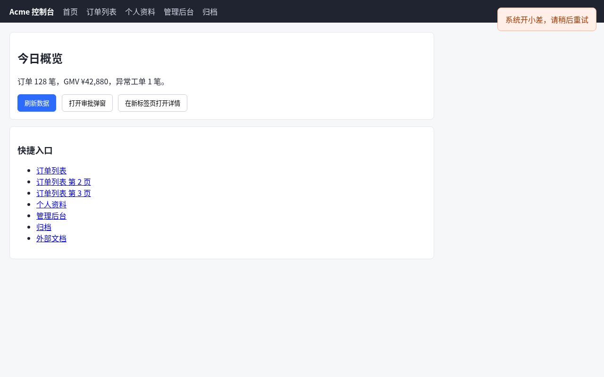

线上故障最常见的形态，其实不是「服务挂了」。挂了反而简单——HTTP 503、探针变红、告警响，谁都知道出事了。

难的是另一种：**页面还在，按钮还能点，功能悄悄没了。**一个接口返回 500，前端 `catch` 住，右下角弹一句「系统开小差，请稍后重试」，页面本身 HTTP 200，探活绿油油。用户来投诉的时候，你的监控面板上什么都看不出来。

我在公司是唯一一个 QA（对，整个测试团队只有一个人），平时测的是 AI 网关这类后台系统。这类页面按钮多、状态多、改造频繁，两种常规手段都不太趁手：

| 手段 | 真实体验 |
| --- | --- |
| `curl /health` 探活 | 用户能点的东西它一个都没碰过。SPA 里接口 500 而页面 200 的场景，它 100% 看不见 |
| 手写 Playwright / Cypress 用例 | 写得出来，维护不起。表格里一个 `<button>` 被重构成 `<div role="button">`，几十条用例一起红；加一个新字段，我得改三处选择器 |

我想要的东西很具体：**给一个根 URL，它自己逛、自己判断有没有坏、自己出报告。我不要写选择器，也不要维护用例。**

于是做了 [jev-inspector](https://github.com/ABK3528/jev-inspector)：Apache-2.0，纯 Python，仓库里约 4,500 行代码（核心包 `jev_inspector/` 2,636 行，其中爬取引擎 `crawler.py` 950 行），**唯一依赖是 `playwright>=1.40.0`**，其余全部走标准库。

## 一、先说清楚：为什么「随便写个爬虫点链接」不行

我一开始也是这么想的，直到发现这类任务有三个死局，任何一个都能让脚本在几分钟内自己把自己弄死。

**死局一：无限下钻。** 一个订单列表页有 30 行，每行 2 个按钮；一个商品站有 100 万个详情页。普通爬虫会一直走下去，内存和算力都耗在同一种模板页面上，而真正关键的结算页、设置页一个都没碰到。

**死局二：状态污染与回溯失败。** 点一个「提交」会永久改变状态；点一个「在新标签页打开」会跳到另一个上下文；点开一个带遮罩的弹窗之后，页面上其它元素全被挡住——Playwright 会一直等「元素可点击」，等到超时为止。页面回不去，整轮巡检就卡在那儿了。

**死局三：标签页泄漏。** 只要站里有 `target="_blank"` 或 `window.open`，无头浏览器的标签页会不断堆积，内存几分钟内就上去，最后把宿主机拖死。

这三条决定了它不是「爬虫 + 循环点击」，而是一套**浏览器状态调度问题**。

## 二、它的做法：四张网



### 2.1 四层递进去重（对付下钻）

| 层 | 做什么 | 我的理解 |
| --- | --- | --- |
| L1 URL 规范化 | 去掉锚点、剔除 `utm_*` 与时间戳、重排 query | 同一个页面别被算成十个 |
| **L2 路径原型配额** | 把 `/items/10001`、`/items/10002` 抽象成 `/items/:id`，每种模板只采样 N 页 | 从根上斩断无限下钻，这是整套里最关键的一层 |
| **L3 DOM 结构指纹** | 向上回溯容器，给 `tr`、`li.card` 这类同构元素算指纹，同一种只测第一个 | 30 行表格不会点 60 次 |
| L4 模型语义去重 | 剩下真需要判断的交给判定层 | 兜底，我这次没配 key，走的是关键词路径 |

### 2.2 三级弹性回溯（对付状态污染）



回溯的三级是从源码里读出来的，`_apply_elastic_backtrack` 这个方法写得很清楚：

- **L1 原位软回溯**：按一次 `Escape`，然后找 `.toast`、`.modal-backdrop`、`button.close`、`[aria-label="Close"]` 逐个点掉/隐藏。注意这一级是**静默的**——它不写 INFO 日志，只在异常时 `debug` 一句。也就是说「弹窗被自动关掉了」这件事在日志里没有痕迹，想确认得看截图或自己加日志。
- **L2 历史回溯**：一旦发现 URL 漂移，`page.go_back(wait_until="domcontentloaded", timeout=4000)`。
- **L3 硬重置**：`go_back` 之后还在错页上，就 `goto` 回基准 URL，重新拿一个干净上下文。

### 2.3 多标签页守护

在 `BrowserContext` 级别挂 `context.on("page")`：所有被 `target="_blank"` 或 `window.open` 打开的新页面都会被抓到，先在它上面做一轮 console / 4xx 检查（子页面的错误也算证据），然后**立刻 `.close()`**。主巡检页面的焦点和浏览器内存因此保持恒定。

### 2.4 判定层：证据链是四路，不是一路

这一点是我最看重的设计。判断「这一页坏没坏」，它同时收四种证据：

1. 提示类 DOM 元素的文本（`.toast` / `.alert` / `[role=alert]` / `[class*=error]` …，且要求元素真的可见）；
2. 这一轮动作之后新增的 console 日志里带 `error` / `fail` / `500` / `失败` 这类关键词的行；
3. 网络层实时拦到的所有 4xx / 5xx 响应（静态资源除外）；
4. `alert` / `confirm` 这类浏览器弹窗的文本。

四路汇总之后再判定，命中就写一条错误记录并**自动截一张现场图**：

```python
error_record = {
    "action": "button['刷新数据'] (xpath: //*[@id=\"refresh-btn\"])",
    "detected_texts": [
        "Console: [error] Failed to load resource: the server responded with a status of 500",
        "Console: [error] 请求失败: HTTP 500",
        "HTTP 500 Internal Server Error on http://127.0.0.1:8765/api/flaky",
    ],
    "error_type": "request_error",
    "jev_confidence": 0.85,
    "severity_score": 0.75,
    "screenshot": "screenshots/error_1791624769615.png",
}
```

## 三、实测一：我造了一个假站点，让它自己去逛

光看代码不算数。为了有个可控的靶子，我用标准库写了一个假站（`http.server`，一共 100 多行），刻意埋了几个典型坑：

- 5 个页面：首页、订单列表（**30 行 × 2 个按钮**）、个人资料（表单 + 下拉 + 复选）、管理后台（tab 组件）、归档（12 条同构卡片）；
- 1 个接口稳定返回 **500**，前端 `catch` 后弹 toast「系统开小差，请稍后重试」，页面本身 200；
- 1 个接口要 **4 秒**才返回；
- 首页一个「打开审批弹窗」按钮（遮罩型弹窗）、一个「在新标签页打开」按钮（`window.open`）、一条指向 `example.com` 的外链；
- 后台两个危险按钮：「清空全部缓存」（命中默认词表里的「清空全部」）和「退出登录」。

服务端还记了一份 `requests.log`——**工具说自己访问了什么不算数，服务器收到什么才算数**，这是我做测试的习惯。

```bash
python3 main.py --url http://127.0.0.1:8765/ --crawl-mode site \
  --max-pages 8 --max-depth 2 \
  --report report.json --html-report report.html --no-fail-on-error
```

一轮 43.99 秒跑完，结果如下（全部取自 `report.json` 与运行日志）：

| 指标 | 实测值 |
| --- | --- |
| 巡检页面数 | 8 |
| 发现 URL 数 | 11 |
| 站点拓扑有向边 | 59 |
| 执行动作数 | 25 |
| 遇到的原生元素 | 832 |
| **去重跳过次数** | **807** |
| 原生元素采样率 | **3.0%** |
| 独立控件指纹 | 25 种（自测 25 种 → `element_coverage_rate` 1.0） |
| URL 原型 | 6 个 |
| 捕获错误 | 1 条（`request_error`，置信 0.85，严重度 0.75） |
| 总耗时 | 43.99 s |

### 它确实抓到了

**① 那个 500 被三路证据一起钉住。** 上面那段 `detected_texts` 就是原始记录：console 报了两行、网络层报了一行，外加快照一张。这是我最想要的能力——**页面 200、探活全绿的时候，它还是把问题揪出来了。**



**② 危险按钮被跳过了。** 日志里就两行：

```text
[INFO] [inspection.engine] Skipping destructive button/action: '清空全部缓存'
[INFO] [inspection.engine] Skipping destructive button/action: '退出登录'
```

整轮跑完，假站的会话没断，`requests.log` 里也没有任何登出/清空相关的请求。对一个要在生产环境跑的巡检工具来说，这条比「多抓几个 bug」重要得多。

**③ 分页原型配额生效了。** 列表页有 `?page=2..6` 五个分页链接，巡检把它们**点开**了（`requests.log` 里 `?page=4/5/6` 各 1 次，点完立刻回溯），但只有 `?page=2`、`?page=3` 被当成页面排队巡检——因为 `/list.html` 这个原型的配额是 3 页（含第 1 页）。`url_archetype_distribution` 里 `127.0.0.1:8765/list.html: 3`，其余都是 1。这就是「无限下钻」被挡住的样子。

**④ 外链弹窗被守护者接住并关掉了。** 点到 `example.com` 那条 `target="_blank"` 外链时：

```text
[INFO] [Multi-Tab Guardian] New window/tab detected: <Page url='https://example.com/external'>
[INFO] [Multi-Tab Guardian] New tab loaded: https://example.com/external
[INFO] [Multi-Tab Guardian] Closed popup tab. Focus preserved on main inspection page.
```

同一轮里，L2 回溯触发了 **12 次**——其中 5 次是在订单列表页里点开分页链接（URL 变成 `?page=N`）之后，引擎发现页面漂移、把页面拉回来的，没有一次卡死在错页上。

### 而这份报告里有个数字「漂亮得可疑」

`element_coverage_rate: 1.0`，也就是控件覆盖率 100%。**同一个响应里，`raw_sampling_rate` 是 0.03。**

两个数字都没错，但它们是两个口径：

- `element_coverage_rate` = 已测指纹 25 / 发现指纹 25 —— 分母是**去重之后**的集合，天然容易接近 100%；
- `raw_sampling_rate` = 25 / 832 —— 分母是页面上真实存在的元素数。

也就是说「100% 覆盖」的意思是「在它认为不同的 25 种控件里，25 种都点过了」，而不是「832 个元素我都碰过」。**看这类报告必须两个数一起看**，只看前一个会得出很舒服但没用的结论。这算是我对这个项目第 1 条改进意见：报告首页应该把两个数并列展示。

还有个更具体的问题：管理后台那页一共 7 个按钮（2 个 tab、3 个工具按钮、2 个危险按钮），**实际只执行了 1 个动作**（点开「统计」tab）——2 个危险按钮被守卫拦下，另外 4 个被结构指纹判成同质元素跳过了，报告依然给 100%。这一页的去重记录长这样：

```json
{"element": "Tag: <a>, Text: '首页', Container: 'standalone', Pattern: 'header > a'",
 "reason": "Structural fingerprint matches already tested container type",
 "signature": "single|a|text:首页|pattern:header > a"}
```

这一轮 **807 次跳过，100% 都出自 L3 结构指纹**（L1 URL 规范化、L2 路径原型配额这两层在这么小的站上根本没被触发）。指纹的原料是「标签 + id/文本 + 路径模式」，所以同一个容器里长得一样的一排功能按钮会被判成同一种控件——省了重复点击，也顺手漏掉了同类里的其它功能。我的想法是按「按钮文本 + 语义」再分一层，或者给关键按钮留个白名单。

## 四、实测二：把「静默失败」拆成 2×2

第一节那个 500 之所以抓得住，是因为它同时有 console 报错和网络 4xx/5xx。**真正难的是三路证据都没有的那种失败**：纯前端状态机弹了一句文案，没有请求、没有 console、没有非 2xx。

我造了第二个靶子：只有一个按钮的页面，点完 **3 秒后**出现一句纯文本提示「校验失败，请联系管理员」——没有 `fetch`、没有 `console.error`。然后做了 2×2 对照，两个变量：

- 提示元素写成 `<div id="toast">`（**不在**扫描器的选择器集合里）还是 `<div id="toast" class="toast">`（**在**里面）；
- `wait_after_action` 用默认的 `1.0` s 还是 `5.0` s。

结果如下（每组一轮，配置只差这两项）：

| 提示元素 | 等待窗口 | 状态 | 捕获到的证据 |
| --- | --- | --- | --- |
| `id="toast"` | 1.0 s | PASSED，0 错误 | 无 |
| `id="toast"` | 5.0 s | PASSED，0 错误 | 无 |
| `class="toast"` | 1.0 s | PASSED，0 错误 | 无 |
| `class="toast"` | 5.0 s | **FAILED，1 错误** | `校验失败，请联系管理员` |



**四组只成功了一组。**两个前提缺一不可：

- **选择器得命中**：扫描器收的是 `.toast / .message / .alert / .notification / .error / .danger / .warning / [role=alert] / [class*=error] / [class*=alert]`。我第一版用 `id="toast"` → 索引不到，等多久都没用。
- **等待窗口得够长**：默认 `wait_after_action = 1.0` s，而提示 3 秒后才渲染，检查那一刻元素还是空的。改成 `5.0` s 立刻抓到。

只有第三、四组之间的差别，才能把「工具没看见」和「页面真没问题」区分开。

:::warning
**教训：`PASSED` 的含义是「这一轮我没看见故障」，不是「这一页没问题」。**静默失败捕获是有前提的，而且这些前提得自己检查。我现在接入任何站点前都会先过三件事：① 站点的提示组件用什么 class / role，在不在扫描集合里；② 关键异步操作多久才渲染结果，`wait_after_action` 够不够；③ 哪几条业务文案是「失败」的意思，要不要补进关键词表。这三条比我第一版写的任何测试脚本都值钱。
:::

## 五、两件得坦白的事

**① 判定层我这次跑的是「关键词兜底」路径。** 配了 `TYPESAFE_API_KEY` 时，页面证据会被丢给 `JevClient` 做一次模型研判；没配（或调用失败）就退化成源码里这一行：

```python
is_err = any(kw in combined_text.lower()
             for kw in ["500", "404", "crash", "error", "失败", "网络错误", "internal server error"])
```

也就是说，**中文文案里没有上面这些词、网络层又没留下痕迹的话，靠兜底是认不出来的**。这也是我在实验二里必须先给假站的 toast 补上 `class="toast"` 的原因。想接自己的判定逻辑，正路是扩展钩子（`BaseExtension` 提供了 `on_page_loaded` / `on_after_action` / `on_error_detected` / `on_finish` 等 7 个挂点）——不过仓库里目前只有基类，没有示例插件，这一块得自己摸索。

**② README 里的测试数字和实测对不上。** 徽章写 `Tests-45_Passing`，README 里写着 `Ran 45 tests in 70.24s`；我在本地跑 `python3 -m unittest discover -p "test_*.py"`，跑了两遍：

```text
Ran 36 tests in 70.318s

OK

Ran 36 tests in 69.168s

OK
```

耗时几乎一模一样（69~70 s vs README 的 70.24 s），**条数差 9 个**。我数了两遍 `def test_`，确实是 36 个。顺带说一句，这套测试不是打桩：里面真的起了本地 HTTP 服务、真的开了 Chromium 跑整站遍历（其中一条用例的单轮巡检就耗时 14.5 秒），这点比数字本身更让我放心。但徽章和 README 该改过来——这是我自己项目，先记在自己账上。

## 六、使用感受

**先说好的：**

- **真的是零脚本。** 从 `git clone` 到出第一份报告，我花的全部时间就是 `pip install playwright` 加上一条命令。这对「被测系统一天改三次」的团队是刚需——巡检脚本的维护成本是个无底洞。
- **产物是给人看的，不是给机器看的。** JSON 里有 summary、站点拓扑、逐个动作、去重记录；同时生成一份 HTML 看板，还能写 Prometheus 指标文件（我这轮就落了一份 `inspection_metrics.prom`，`web_inspection_status{target=...} 0`），告警模块内置了飞书/钉钉/企微/Slack 四种 webhook 格式。
- **它和确定性用例是互补的，不是替代关系。** 这点是我想清楚之后才明白的：探索式巡检负责「在我没写用例的地方高频扫一遍」，仓库里的 flow 引擎（`goto / click / fill / assert`，带 `text_contains`、`visible`、`url_matches` 断言和 SLA 时延违约判定）负责「关键链路必须准」。我的用法是 90% 探索 + 10% 关键链路确定性用例，比纯靠任何一边都稳。
- **危险动作有一道闸。** 词表可配，命中即跳过——这是敢把它指向真实生产环境的前提。

**再说代价和没解决的：**

1. **单站串行，站点一大就慢。** 8 页 44 秒，平均每页 4~5 秒；并发调度在 `scheduler.py`（ThreadPool + SQLite 存历史 + `/health` `/metrics` 探口）这一层，单站内部仍是串行。大站要拆成多个候选入口并行跑。
2. **两个覆盖率要一起看**（见第三节），报告首页目前只突出一个，容易误导。
3. **L3 结构指纹对「同容器内的一排功能按钮」过于激进**，会把还该点的按钮一起去重掉。需要白名单或自定义钩子补。
4. **判定层依赖关键词或外部模型**，中文文案要么进词表，要么走钩子；这块是目前最薄的一环。
5. **等待窗口和动作超时是两个不同的旋钮。** `action_timeout_ms`（默认 5000）管的是单次交互能不能点成功，`wait_after_action`（默认 1.0 s）管的是点完之后给异步渲染留多久——实验二翻的就是后一个的盘。
6. **README 和徽章的数字要跟实测对齐**（上面第 ② 条）。

**一句话总结：**这个工具的价值不在于「覆盖所有按钮」——那份 100% 的覆盖率随时可能骗你；它的价值在于**在我没写用例、探活也照不到的地方，它能自己逛过去，并且在页面仍然返回 200 的时候把故障钉住。**一个只有一个人的测试团队，这种「不用维护的覆盖率」比多写 50 条用例实在得多。

## 七、如果你也想试

```bash
git clone https://github.com/ABK3528/jev-inspector.git && cd jev-inspector
pip install -r requirements.txt && playwright install chromium

# 整站巡检一轮
python3 main.py --url https://your-app.com --crawl-mode site \
  --max-pages 10 --max-depth 2 --report report.json --html-report report.html

# 常驻 + 健康检查/指标端口
python3 run_inspection.py --config sites_config.sample.json --serve --port 8089
# CI 里让它失败即退出（错误数 > 0 时返回码 1）
python3 main.py --url https://your-app.com --fail-on-error
```

接入生产前，建议按第四个实验的结论先做三件小事：把站点的提示组件选择器核对一遍、把 `wait_after_action` 调到覆盖你的异步渲染时间、把「失败」类文案补进关键词表。做完这三步，`PASSED` 才值得信。

## 参考

- 项目仓库：<https://github.com/ABK3528/jev-inspector>（Apache-2.0）
- 仓库里 README 记录的公网实测（Hacker News 8 页、1,067 条拓扑边、2,128 个元素去重掉 2,104 个、44.76 s）：我**没有复跑**，只作为作者自测记录引用；本文所有数字都来自我自己那两组本地实验
- 追问某一行行为时的入口：`jev_inspector/engine/crawler.py`（去重、回溯、判定、标签页守护都在这个文件里）、`jev_inspector/decision/jev_client.py`（模型客户端）、`jev_inspector/extensions/base.py`（7 个扩展钩子）